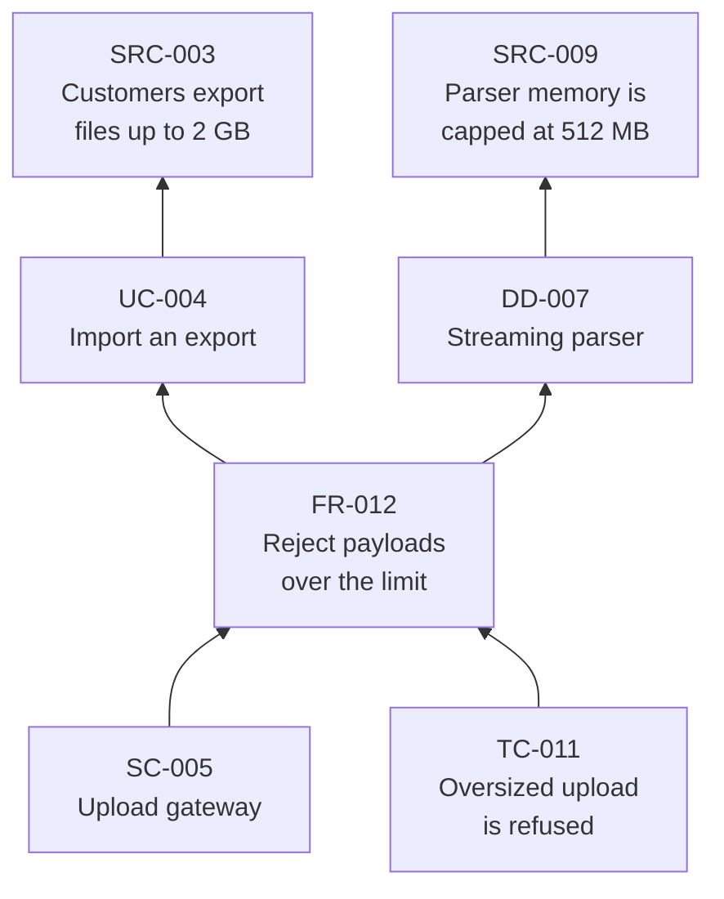
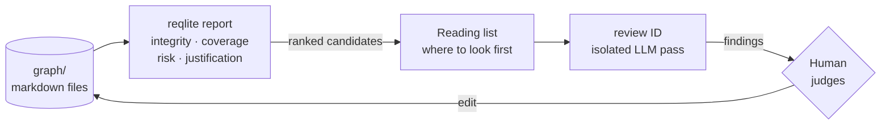
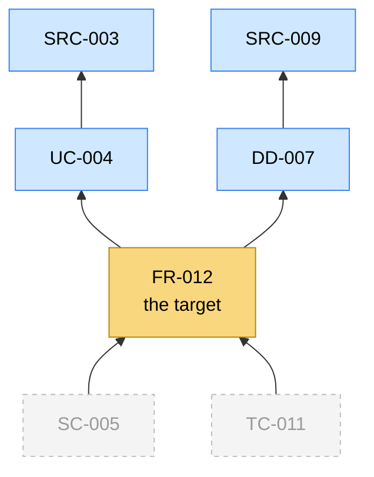
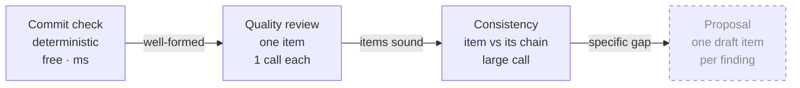
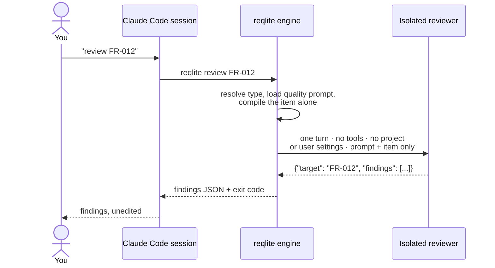
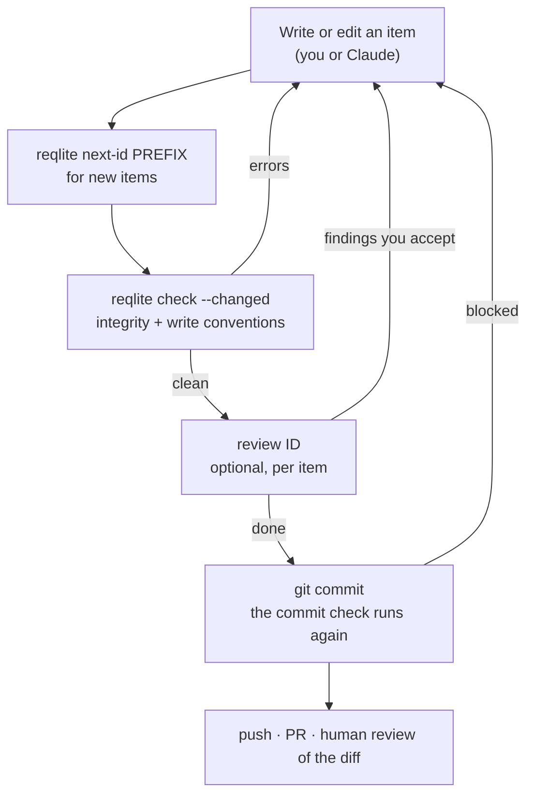
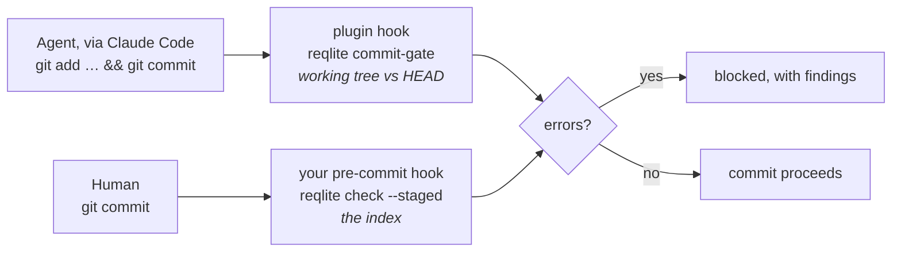

# reqlite user guide

reqlite manages requirements as a graph of plain markdown files in a git repository, and
analyses that graph in two ways. **Algorithms** check its structure: free, instant, and
the same every time. **A language model** judges what the text means: it costs money,
and its answers are useful but vary from run to run. This guide covers the daily workflow
and explains how the two modes divide the work. Getting that division right is the main
idea behind the tool.

It assumes you are comfortable with git, the command line and markdown, and have used
Claude Code.

---

## 1. The model in five minutes

### Items

An **item** is one unit of thinking: an observed constraint, a use case, a capability, a
decision, a component. Each one is a markdown file:

```markdown
---
certainty: assumed
negotiability: negotiable
---

# FR-012: The system must reject payloads over the configured limit

Users upload exports from [UC-004](UC-004-import-export.md); the limit protects the
parser described in [DD-007](DD-007-streaming-parser.md).
```

- **The filename is the identity.** `FR-012-reject-large-payloads.md` *is* `FR-012`.
  There is no `id`, `title` or `status` field. The title is the first heading.
- **The frontmatter is optional** and carries only judgment, such as how certain the
  claim is and how negotiable. The project's ruleset decides which fields exist.
- **The prefix (`FR`, `UC`, …) is the type**, and every project defines its own types.
  This repository uses SRC (source input), UC (use case), FR (functional requirement), DD
  (design decision), SC (solution component) and TC (test case), but nothing in the engine
  depends on those names.

### Links

A link is an ordinary markdown link to another item's file. It means **"I rest on this"**,
and it always points at what justifies the item, never at what depends on it. The links
form a directed acyclic graph (DAG) with the raw inputs at the bottom:



*Arrows point at foundations. The SC and the TC both rest on the FR but never on each
other: the test checks the capability, not the implementation.*

Nobody stores the edges. They are parsed from the body text every time an analysis runs,
so the files are the whole system: no database, no index, nothing to keep in sync.

### Why links point downward

The rule behind the design is YAGNI applied to requirements: **an item that nothing
justifies is speculative scope**. Because every item links to what it rests on, two
questions become facts you can check rather than judgment calls: "why does this
exist?" (follow the links down) and "what breaks if this changes?" (follow them up).

### No status, no archive

An item is live because it is in the graph. To retire one, move whatever is still
valuable into the items that should carry it, remove the links pointing at it, and
delete the file. Git history is the archive, and the commit message says where the
value went. Retired ids are never reused; `reqlite next-id` reads the git history to
make sure of that.

---

## 2. Install and first run

You need Claude Code and [uv](https://docs.astral.sh/uv/) 0.4 or later.

```bash
claude plugin marketplace add major-solutions/reqlite
claude plugin install reqlite@reqlite
```

This installs two skills, `reqlite` (methodology, authoring, analysis) and `review` (LLM
quality review). You mostly work by asking Claude in plain language, and the skills run
the engine for you. Every command also works directly from the terminal, without a clone,
through a pinned release:

```bash
uvx --from "git+https://github.com/major-solutions/reqlite@v0.1.7" reqlite <command>
```

The plugin's own copy lives in Claude Code's plugin cache under a path that changes with
every update, so do not point anything at it. In a clone, `pip install -e .` puts
`reqlite` on your PATH.

A project is a flat `graph/` directory with a `ruleset/` directory beside it:

```text
my-project/
├── graph/                     ← every item, no subfolders
│   ├── SRC-001-....md
│   └── FR-001-....md
└── ruleset/
    ├── ruleset.json           ← types, fields, declared analyses, write conventions
    ├── readme.md              ← optional: the intent behind your type boundaries
    └── prompts/               ← one quality-review prompt per type
```

The first two commands to run:

```bash
reqlite doctor     # can everything run? engine, graph, ruleset, review extra, credentials
reqlite report     # the full structural picture
```

To start a new project, run `reqlite init` in it. It creates `graph/` and copies a shipped
ruleset into `ruleset/`: by default reqlite's own, or another with `--ruleset <name>`, or
your own ruleset directory with `--ruleset <path>`. The copy is yours. reqlite does not
help you design a type system: writing a good one takes experience, and a vague one makes
every finding meaningless. If you change the copy, run `reqlite check-ruleset` (§6)
afterwards.

### In VS Code with GitHub Copilot

reqlite also works as an agent plugin in VS Code with GitHub Copilot Chat. Tested on
Windows with VS Code 1.138 and Copilot Chat 0.66, in the local agent, with the plugin
loaded from a local clone. Not tested yet: macOS and Linux, the Copilot CLI agent, and
installing from a marketplace or a Git URL.

1. Turn on agent plugins: `"chat.plugins.enabled": true` in your settings. Your
   organisation may control this setting.
2. Install it in one of these ways:
   - From a local clone (the tested route):
     `"chat.pluginLocations": { "<path to the clone>": true }`.
   - From the Command Palette: **Chat: Install Plugin From Source**, with the URL
     `https://github.com/major-solutions/reqlite`.
   - From the marketplace: add `"chat.plugins.marketplaces": ["major-solutions/reqlite"]`,
     then search the Extensions view for `@agentPlugins` and install `reqlite`.

   VS Code marks `chat.pluginLocations` and `chat.plugins.marketplaces` as experimental.
3. Reload the window, or start a new chat, after installing or updating: hooks are read
   when a session starts.

Both skills work as they do in Claude Code. The commit check behaves differently:

- **It runs before every tool call**, not only before commits, and adds 2–3 seconds to
  each (§10). It acts only on commits.
- **A blocked commit shows its message twice**, once for each of the check's two hook
  entries.
- **On Windows, hooks run in Windows PowerShell** by default, and the check follows
  PowerShell's directory changes (`Set-Location`, `$env:X`; §7).

To see what the check did, open the Output panel and select **GitHub Copilot Chat Hooks**.
It lists each hook run, its result (`Success`, `NonBlockingError` or `Error`) and its
output.

---

## 3. Two kinds of analysis

| | Algorithmic | Inferential |
|---|---|---|
| Who runs it | the engine, deterministically | a language model, in an isolated process |
| What it reads | links and frontmatter | the meaning of the text |
| Cost and speed | free, milliseconds | one model call per item, 10–60 s |
| Repeatability | identical every run | varies; measured at about ±1 finding per item |
| Its verdict | authoritative on structure | evidence for a human to weigh |
| Examples | integrity, coverage, risk ranking, commit check | quality review of one item, the consistency check, the ruleset check's semantic half |

Each mode is weak exactly where the other is strong. The algorithms cannot read: to
the engine, the link "this scenario exists *because of* SRC-022" counts the same as "this
relies on SRC-007 *being reasonably reliable*". The model can read, but it miscounts,
misses items, and gives slightly different answers each time. reqlite gives each mode
the work it is good at and **never lets one stand in for the other**.

### Synergy 1: structure narrows the field, inference judges it

An algorithmic result is a **reading list, not a conclusion**. "SRC-003 carries the most
downstream risk" means *read SRC-003 first*, not *SRC-003 is the biggest risk*. Whether
it matters depends on what the linking items actually say, and judging that is the
model's job (or yours).



Without the structure you would ask a model to "review my requirements" and get a
plausible tour of whatever it noticed first. With the structure, the model is
pointed at the few items where a defect would cost the most.

### Synergy 2: the graph assembles the context

A model's answer depends heavily on what is in its context window. reqlite never leaves
that to chance: the engine **compiles** the context from the graph, deterministically.



*Same example graph as above. Quality review sees only the yellow item, plus its type's
prompt. `reqlite compile FR-012` adds everything blue: the transitive foundations. The grey
dependents are in neither, because what rests on an item does not justify it.*

- **Quality review** gets the item alone plus its type's prompt. Quality is a property of
  the item itself, so anything else in the context would be noise, and a finding
  points at exactly one item.
- **`reqlite compile <ID>`** walks the DAG and renders the item with every item it rests
  on, foundations first. It is the right context for "does this hold up against
  everything beneath it?" Reading a whole justification chain in one context window is
  what makes the shallow graphs practical: a large context window does the work that a
  deep hierarchy of intermediate documents used to do for human readers.

The same graph always compiles to the same input. Variation in the output then comes
from the model alone, not from whatever context the model was given.

### Synergy 3: cheap checks gate expensive ones

Analyses run in order of cost, and each one gates the next:



*The dashed step is designed but not yet available in the local tool (see §10).*

- Do not spend tokens on an item that does not even parse or that breaks the ruleset.
  The commit check catches that for free.
- Do not run consistency over items that fail quality review. A contradiction between a
  well-written item and a badly written one cannot be traced to its cause: it might be
  real, or it might come from the poor wording. This gate is advice: Claude offers to
  review the chain first, and the tool does not enforce it.

### Synergy 4: no inference where a computation exists

When a fact can be computed, the engine computes it, and a model never infers it.
Which id comes next, whether a link resolves, whether the graph has a cycle, which
items a change touches: each of these has a command. The skills tell Claude to run
the command rather than reason it out, because an inferred answer that sounds right
does the most damage exactly when it is wrong. One example: under the old manual rule
reqlite's own graph reused a retired id, which is why `next-id` now exists.

The reverse holds too. The engine does not judge meaning: no keyword heuristics, no
link weights. Whether a link is definitional or incidental is a question about the text,
so it goes to a model or a human.

### Synergy 5: inference runs in isolation

A review run inside your authoring conversation would be marking its own homework: it
would carry the drafting history, your instructions and its own earlier opinions. So
`review` runs in a separate process:



The reviewer sees only what the engine compiled for it. Its findings can therefore be
repeated by anyone with the same graph and prompt, and they are independent of whoever
wrote the item.

### Synergy 6: two kinds of confidence

- **Authored** values (`certainty`, `negotiability`) are judgments that a person writes
  down. Quality review checks them against the text, for example "marked *verified*, but
  cites no evidence".
- **Derived** values (foundation risk) are computed by the engine from the graph. For
  example: how much of what we build rests on assumptions nobody has verified?

The model critiques the authored values and the engine computes the derived ones.
Neither writes the other's, and **nobody but the owner changes an authored value**.

---

## 4. The daily loop



In practice you ask Claude something like *"add a use case for importing an export, it
rests on SRC-003"*. The `reqlite` skill reads your ruleset's type definitions, allocates
the id, compiles the foundations so the new item fits what it rests on, writes the file,
and runs the check. It proposes a commit message but does not commit unless you ask.

---

## 5. Reading `reqlite report`

`report` is the main analysis. It runs in this order:

1. **Integrity**: unknown references, duplicate ids, cycles. If this fails, fix it first:
   nothing after it means anything on a broken graph.
2. **Topology and orphans**: sources, middle items and leaves; items with no links at
   all. These describe the graph; they are not failures.
3. **Declared analyses**: whatever your ruleset declares, each with a severity of your
   choice. This repository declares five:

| Analysis | Question | Severity |
|---|---|---|
| `coverage` | Does every FR have at least one SC realising it? | warn |
| `assumption_risk` | For each SRC: how uncertain is it, and how much rests on it? | info |
| `unsupported_assumption` | Which unconfirmed SRCs does nothing rest on? They score 0 in `assumption_risk`, so link them or confirm they are unused. Lists only the flagged items. | warn |
| `justification` | Is each SC backed by at least one *verified* SRC somewhere beneath it? | warn |
| `effort_distribution` | Which SCs are large enough to deserve decomposition review? | info |

Declared analyses are written in a small, deliberately limited query language in
`ruleset.json`: min, max, sum, count and value over the graph, combined by a whitelisted
expression. The engine has no opinions of its own. If a question needs more than that
language offers, load the graph into a real graph database for the occasion rather
than extending the engine.

Read the output as a reading list (Synergy 1). The items it ranks highest are the
first candidates for `review`.

For exploring:

```bash
reqlite connections FR-012                                   # direct links both ways
reqlite connections FR-012 --mermaid --direction both --depth 2
reqlite compile FR-012                                       # the full chain as one document
```

The `--mermaid` output pastes straight into any markdown that renders mermaid, including
GitHub.

---

## 6. Quality review

Ask Claude to *"review FR-012"*, or use `/reqlite:review FR-012`.

- **Who pays.** By default, the Anthropic API key in `REQLITE_API_KEY` (see *Setting up
  a key* below). `--gateway` sends it through your company's gateway or cloud provider
  (see *Through a company gateway* below). The skill asks once per conversation before
  the first review, and again before more than five.
- **What you get back.** A JSON list of findings, each with a category, a summary and its
  reasoning. Your type's prompt defines the categories. This repository's FR prompt, for
  instance, checks for `not_testable`, `solution_leakage`, `misclassified`,
  `bundled_capabilities` and `certainty_evidence_mismatch`.
- **How to read it.** Findings are evidence, not verdicts. An empty list means the
  reviewer found nothing, which is not proof that the item is sound. Identical runs differ
  by about one finding per item, so do not treat a one-finding difference as meaningful,
  and do not re-run an unchanged item hoping an unwelcome finding goes away. Re-review
  after you edit.
- **What it never does.** It never edits anything. You decide which findings to act on.

The quality prompts in `ruleset/prompts/` are part of your project, so you can tune them.
A vague type definition produces vague findings, so the type descriptions in your ruleset
deserve more care than any single item.

### Setting up a key

1. **Create a key for reqlite alone** in the [Anthropic Console](https://platform.claude.com),
   ideally in a workspace with a spend limit. Nothing on your machine can hide a key from
   software running as you, so the limit, and being able to revoke this one key without
   touching others, is what protects you if it leaks.
2. **Put it in `REQLITE_API_KEY`**, typed at a prompt so it stays out of your shell history:

   ```powershell
   # PowerShell 7 on Windows, persistent for your user
   [Environment]::SetEnvironmentVariable('REQLITE_API_KEY', (Read-Host 'key' -MaskInput), 'User')
   ```

   ```powershell
   # Windows PowerShell 5.1 (the one Windows ships), persistent for your user
   $s = Read-Host 'key' -AsSecureString
   [Environment]::SetEnvironmentVariable('REQLITE_API_KEY', [Net.NetworkCredential]::new('', $s).Password, 'User')
   ```

   ```bash
   # macOS / Linux, this shell only
   read -rs REQLITE_API_KEY && export REQLITE_API_KEY
   ```

   To keep it on macOS or Linux, export it from your shell profile, or better, read it
   there from your keychain or password manager.
3. **Restart** the terminal or editor you run Claude Code in. A program only sees
   variables that were set before it started.
4. Check with `reqlite doctor`: the `key review` line says whether the variable is set.
   It never prints the key.

Already keep a key in another variable? Pass `--api-key-env THAT_NAME` to any inferential
command (and to `doctor`). Never paste a key into the chat: everything there is stored in
the session's transcript. If that happens, revoke the key.

Why not `ANTHROPIC_API_KEY`? Claude Code itself prefers that variable over your login, so
setting it would switch every Claude Code session on your machine to the key. reqlite
passes the key only to the review process it starts. Key mode also refuses to run when
`ANTHROPIC_BASE_URL` or a cloud-provider variable is set, because the key would then go to
another server or be ignored, and it checks that the review process really used the key
before showing you a result.

### Through a company gateway

If your company routes Claude through a gateway (`ANTHROPIC_BASE_URL`, for example
Portkey or LiteLLM) or through Bedrock or Vertex, key mode refuses,
because the review would leave the path your company set. `--gateway` uses that path
instead, and the review is billed to whatever it routes to.

- **Inside Claude Code** with the gateway set in `settings.json` → `env`, pass `--gateway`
  alone. The review process gets the same gateway variables your session has.
- **Elsewhere** (another editor's agent, a plain terminal), name the gateway yourself:
  `--gateway --gateway-url URL --gateway-key-env NAME [--gateway-header HEADER]`. The
  key comes from the variable `NAME`, sent as a bearer token unless `--gateway-header`
  names the header your gateway expects, for example `x-portkey-api-key`. A
  `--gateway-url` other than your session's `ANTHROPIC_BASE_URL` always needs
  `--gateway-key-env`: your session's gateway key is never sent to another URL.
- **The model id.** Gateways use their provider's ids, so `--gateway` takes the model from
  `ANTHROPIC_DEFAULT_SONNET_MODEL`, or from `--model`. With neither, it refuses.
- **What it guarantees.** The review process runs with an empty, throwaway Claude
  configuration directory, so it cannot reach your stored Claude login. If the gateway
  setting were missing or ignored, the review would fail with "Not logged in" rather than
  be billed to your personal subscription. A failed request is retried at most twice, so
  a wrong gateway setting fails within seconds.
- `reqlite doctor` has a `gateway review` line (pass it the same `--gateway-…` options).
  It shows the kind of gateway and the model, never the URL or the key.

### Checking an item against its chain

Ask Claude to *"check FR-012 for consistency"*, or run `reqlite consistency FR-012`. The
item and everything it rests on, directly or indirectly, go to the model in one call,
foundations first. The model reports contradictions, unsupported claims, undefined
concepts, and references it can't trace. `--depth 1` limits the check to the item's
direct foundations.

- **Review the chain first.** Claude offers to review the chain's items before the check.
  Findings on an unreviewed chain may come from wording rather than substance.
- **The scope is stated.** The output lists every item that was in context. A pass means
  "nothing found among these", nothing more. If the model's own list differs from the
  engine's, the output says so.
- **Your types come from your ruleset.** The check's instruction is your
  `prompts/consistency.md`, and the type descriptions it reads are the ones in
  `ruleset.json`, so the prompt doesn't need its own copy of your type system.
- **What to expect.** When tested, a direct contradiction with a linked item was the top
  finding on every run, on short and long chains alike. Missing links mostly go
  unnoticed: an item you never linked is never sent to the model. On long chains each
  run reports a different few of the real issues, so compare several runs and trust
  what recurs. One call takes from under a minute to about four.

### Checking the ruleset itself

Ask Claude to *"check the ruleset"*, or run `reqlite check-ruleset --algorithmic` (free)
or `reqlite check-ruleset` (adds one model call, billed like a review). The free half
checks that prompt files exist, that the id pattern compiles, and that every declared
analysis can run. The model call
runs only when that half is clean, and asks whether your types can be told apart:
which pairs could both claim the same statement, with no rule to choose between them.

Read its output across several runs. A real overlap between two types came back on every
run when tested, but most of any single run's list changes from run to run. The model's
instruction is reqlite's own and cannot be replaced from your ruleset, so a checker can't
end up agreeing with the rules it judges. It does not check whether a type's quality
prompt covers what the type's description says matters.

---

## 7. The commit check

The same deterministic check runs automatically when you commit:



- **The whole graph** is always checked for integrity. A retirement that leaves a link
  behind is blocked even though the linking item was never touched.
- **Only the items you change** are checked against the write conventions: filename, id
  pattern, prefix, heading, fields and their allowed values. Older violations surface
  when someone next edits those files, so you can switch the check on for a graph that
  doesn't comply yet.
- Run `reqlite check` with no flag to see every violation in the graph at once.

- **The agent is told not to work around it.** The block message says so, because it is
  the only reqlite text sure to be in the agent's context at that moment. If you want the
  commit anyway, make it yourself, outside the agent.
- **Projects are found anywhere in the repository**, by a `ruleset/ruleset.json` with a
  `graph/` beside it. A project at the top level is checked on every commit; one in a
  subfolder only when the commit changes something under its `graph/` or `ruleset/`, so
  a deliberately broken example project elsewhere does not block unrelated work.
- **`git commit`, `git -C <dir> commit` and `cd <dir> && git commit` are checked**, the
  last two in `<dir>`. PowerShell's `Set-Location`, `sl` and `Push-Location` count as
  `cd`, and an environment variable in the target (`$env:X`, `$X`, `%X%`) is expanded.
  Other git commands are not checked, even when they mention "commit". Not covered:
  `sh -c`, aliases, `env GIT_DIR=…`, and a variable set inside the agent's own session.
- **New items' fields are listed.** `check --changed` warns with the front-matter fields
  each new item sets, so you can confirm that the values are yours.

What it is not: it runs on your machine, and anyone can skip it (`--no-verify`, a
different command form, committing outside Claude Code). It catches mistakes, not
intent. Enforcement that cannot be skipped needs branch protection on the remote.

---

## 8. Tracing code to the spec

Code, scripts, configuration and notes trace back to the items that justify them through
**fences**: a pair of comment lines around a span, in any text file.

```text
<comment> reqlite:begin <ID>[, <ID>...] [test]
...the span...
<comment> reqlite:end <ID>
```

The comment is whatever the file's language uses: `#`, `//`, `/* */`, `--`, `;`, `%`,
`<!-- -->`, `::`, `rem` or `'`, or none in a plain text file. The marker must be the first
thing on its line. `end` names exactly one id, the first of its `begin`. Fences nest; they
must not overlap.

After the ids, a `begin` may carry the role `test`, and either line may end with the
comment's closer (`-->` or `*/`). Nothing else may follow. A **test fence** wraps code that
checks its ids rather than realising them, such as a unit test fenced with the id of the
component it tests (§9). It never counts as a realisation.

```sh
reqlite fences src scripts --expect SC
```

It reports, in this order:

- **Integrity**, which makes the command exit 4: a `begin` with no `end`, an `end` with no
  `begin`, an `end` naming a different id than the innermost open `begin`, an id that
  is not in the graph, and unexpected text after the ids (a misspelt role, a trailing
  comma, a role on an `end`).
- **Unrealised items**: items of each `--expect` type that no fence names, test fences
  not counted. Nothing is assumed without the option, and a type no item has is a
  warning, not a clean result.
- **Unfenced lines in fenced files**: line ranges outside every fence that hold text. Put
  one fence around the whole file and finer ones inside it, or a file's imports and
  header show up here.
- **Files with no fence**: counted; `--unfenced-files` lists them.

Exit 1 means the run could not start: no graph directory, a path that does not exist, or
an item that does not parse. A file that cannot be read is a warning and is skipped.

`--list` lists the fences, `--json` prints everything as JSON. Warnings go to stderr in
both modes, so the JSON on stdout stays clean. The paths you give are the scope. Binaries
are skipped, and so are directories named `.git`, `.venv`, `node_modules`, `build`,
`dist`, `__pycache__` or `*.egg-info` below those paths, and the graph folder; `--ignore
PATTERN` (repeatable) adds a directory name or glob. A path you name explicitly is
always scanned, even if its name matches a pattern. A folder below the paths that is a reqlite
project of its own (a `ruleset/ruleset.json` beside a `graph/`) is skipped too, because its
fences name its own graph; name it explicitly to scan it.

Fences are matched line by line, not parsed: a marker that starts a line inside a string
or a markdown code block counts too. A placeholder such as `<ID>` never matches, which is
how this guide can show the grammar; by the same rule a mistyped marker (`reqlite:begin
sc-1`) is not a marker at all, so it shows up as unfenced text, not as an error. JSON has
no comments, so a JSON file cannot be fenced yet.

---

## 9. Tracing tests to the spec

`fences` shows that code is justified. `trace-compare` checks the tests: it takes the lines
each test executed in a real run and compares them with what the graph says that test
should reach.

```sh
reqlite trace-compare observed.json src tests
```

**Fence the tests.** A unit test is fenced with the id of the component it tests and the
role `test`. A system test, which implements a test case, is fenced with the test case's
id. Fence by function: one test function per fence, and in the code a component's own
functions, so that a unit never shares a function with another one.

```text
# reqlite:begin <component id> test
def test_rejects_negative_gain(): ...
# reqlite:end <component id>

# reqlite:begin <test case id>
def test_gain_end_to_end(): ...
# reqlite:end <test case id>
```

**What it expects.** A component realises a requirement when its links lead to it through
design decisions only. Links between two components, or between two requirements, do not
spread realisation. A test case verifies the requirements its links lead to in the same
way. A component's direct links to other components are its declared dependencies.

**What it reports.** Exit 4 on a blocking finding. By default only `untraced_test` blocks,
and the ruleset can change that (below). Fence integrity problems always block, because
lines cannot be attributed without well-formed fences.

| Finding | Meaning |
|---|---|
| `untraced_test` | a test inside no unit-test fence and no test-case fence |
| `test_misses_target` | a unit test that never ran its component (saying so when other tests do run it); a system test that ran none of its requirement's components |
| `partial_system_test` | a requirement's system tests, together, missed some of its components |
| `not_a_unit_test` | a unit test ran another component, outside its own function, that is not a declared dependency |
| `undeclared_coupling` | two components such a test ran together, with no link between them in either direction; an unordered pair, because line coverage cannot tell which called which. A reach that another reached component's declared dependency explains is not reported |
| `coincidental_coverage` | a component run only by tests unrelated to its requirements |
| `no_unit_test` | a component with no unit test (only with `require_unit_test`) |
| `unexecuted_realisation` | a component no passing test ran |
| `unjustified_code` | an executed line outside every fence, in a file that has a realisation fence and no tests. An executed file with no fence at all is listed in a note: `fences` already reports it as unfenced |
| `mixed_role_fence` | a fence naming both a component and a test case |

Failed and skipped tests run nothing for the comparison. Ids of other types in a fence are
ignored, with a note. After the findings comes a table per component, over its executable
fenced lines: the share run by any test (**suite**), by tests sharing one of its
requirements (**related**) and by its own unit tests (**unit**). "100% suite, 0% unit" is
the line a reviewer needs; a component with no unit test at all shows `-` there instead.

A test case with no fenced test runs nothing, so `trace-compare` cannot see it: `reqlite
fences --expect TC` lists the test cases no fence names.

Exit 1 means it could not run: no graph directory, a missing path, observed data that is
not UTF-8 JSON or not format version 1, or **stale** data: a file's content differs from
the run's, or a fenced file inside the declared `scope` is missing from it (added since the
run). Hashes ignore line endings, so a Windows checkout of the same commit is not stale.
`--json` prints the result; `-o FILE` writes the expected matrix (requirements,
components, test cases, fences and file hashes) as a record of the run.

**Configuration** lives in the ruleset under a top-level `observed_trace` key. Without it
the defaults apply and a note says so. `check-ruleset` validates it.

```json
"observed_trace": {
  "requirement_type": "FR", "implementation_type": "SC", "verification_type": "TC",
  "intermediate_types": ["DD"], "require_unit_test": false, "blocking": ["untraced_test"]
}
```

### The observed data format, version 1

An **adapter** writes this file from your test tool's own output. It needs no knowledge of
the graph, so it can be a short script in any language, for any tool that records
coverage per test. An example for pytest ships in `examples/adapters/pytest_observed.py`.

```json
{"contract": 1,
 "source": {"tool": "pytest-cov", "commit": "4f2a9c1", "metric": "line"},
 "files": {"src/gain.py": "<sha256>", "tests/test_gain.py": "<sha256>"},
 "scope": ["src/**/*.py"],
 "executable": {"src/gain.py": [3, 4, 6, 9]},
 "outside_tests": {"src/gain.py": [1, 3, 8]},
 "functions": {"src/gain.py": [[3, 6, "gain"], [8, 9, "clamp"]]},
 "tests": [{"name": "tests/test_gain.py::test_scales", "file": "tests/test_gain.py",
            "line": 12, "outcome": "passed", "executed": {"src/gain.py": [4, 6, 9]}}]}
```

- `contract` is the format version. Paths are relative to the project root, with `/`.
- `files`: the sha256 of every file the data names, computed **after replacing CRLF with
  LF**.
- `scope` (optional): globs for what the tool measured (`*` within a directory, `**`
  across directories). It promises that every matching file is in `executable`, so a
  fenced file that matches but is missing makes the data stale. Without it, a file added
  since the run cannot be told from one the tool does not measure.
- `executable`: every line coverage could have recorded, per file. This is the
  denominator.
- `outside_tests` (optional): lines that ran, but only outside every test's own run:
  definitions executed at import, collection, fixture setup. They are taken out of every
  figure. A tool that records only statements inside functions leaves it out.
- `functions` (optional): function spans, the unit boundary for `not_a_unit_test`.
  Without them the boundary is the file, and a note says so.
- `tests`: one entry per test. `line` is where its fence finds it (the `def` line, or
  `null` if unknown). `outcome` is `passed`, `failed`, `skipped` or `error`. `executed`
  holds only the lines run by the test itself, not by its fixtures' setup or teardown.

An adapter must not run reqlite or read the graph. Write the file directly rather than
through shell redirection: Windows PowerShell 5.1 writes UTF-16, which is refused.
Per-test coverage must come from the tool; a single combined report cannot be split by
test.

---

## 10. Current limits

- **Three inferential analyses are available locally:** single-item quality review, the
  consistency check, and the ruleset check. The others are designed but do not run yet:
  layer (contradictions among items of one type), custom analysis (your own question over
  items you choose) and proposals. If you ask for one, the
  skills tell you so rather than improvising it in the conversation.
- **The model can still invent values when it writes many items at once.** On a long
  bulk-authoring turn it may set `certainty`, `negotiability` or `effort`, or add
  alternatives and caveats, that you never gave it. reqlite cannot stop this, but it
  shows it: `check --changed` lists every judgment field each new item sets, and the
  skill repeats that list when it hands back. Read it before you commit, and run the
  consistency check on new decisions. It is what caught a paraphrased constraint in
  testing.
- **Keys come from environment variables only.** Fetching a key from a password manager
  at call time is planned.
- **Gateway mode does not support macOS or Microsoft Foundry.** On macOS the Claude login
  is stored in the Keychain, and it is not yet verified that the review process cannot
  reach it there. Bedrock and Vertex are supported but not yet tested against the real
  services.
- **The commit check covers agent commits made through the plugin.** Human commits are
  covered only if you add a git pre-commit hook; reqlite does not install one for you.
  Save this as `.git/hooks/pre-commit` (and make it executable on macOS and Linux):

  ```sh
  #!/bin/sh
  exec uvx --quiet --from "git+https://github.com/major-solutions/reqlite@v0.1.7" \
    --exclude-newer 2026-10-24 reqlite check --staged graph
  ```

  It needs `uv` on the PATH git runs hooks with. The version is pinned, so it does not
  follow plugin updates: bump the tag when you update the plugin, or your own commits and
  the agent's are checked by different engines.
- **In VS Code's agents the commit check adds 2–3 seconds to every tool call.** VS Code
  runs plugin hooks without Claude Code's filters, so the check starts before each tool
  call, file reads included. It returns at once for anything that isn't a commit, so the
  cost is only the engine's start-up, about 1.5 s for each of its two hook entries.
  The entries stay separate because merging them would make Claude Code pay that
  start-up on every shell command.
- **The ruleset library holds one entry**, reqlite's own. More are planned.
- **Windows PowerShell may show `ΓÇö` for `—`** when it captures reqlite's output, which
  is UTF-8. Run `[Console]::OutputEncoding = [Text.UTF8Encoding]::new()` in that session,
  or add it to your profile.

---

## Where to go next

| You want | Read |
|---|---|
| Every command and its output | `skills/reqlite/references/commands.md` |
| How to write an item well | `skills/reqlite/references/authoring.md` |
| Why the method is shaped this way | `skills/reqlite/references/methodology.md` |
| Your project's type boundaries | `ruleset/readme.md` in your project, after `reqlite init` |
